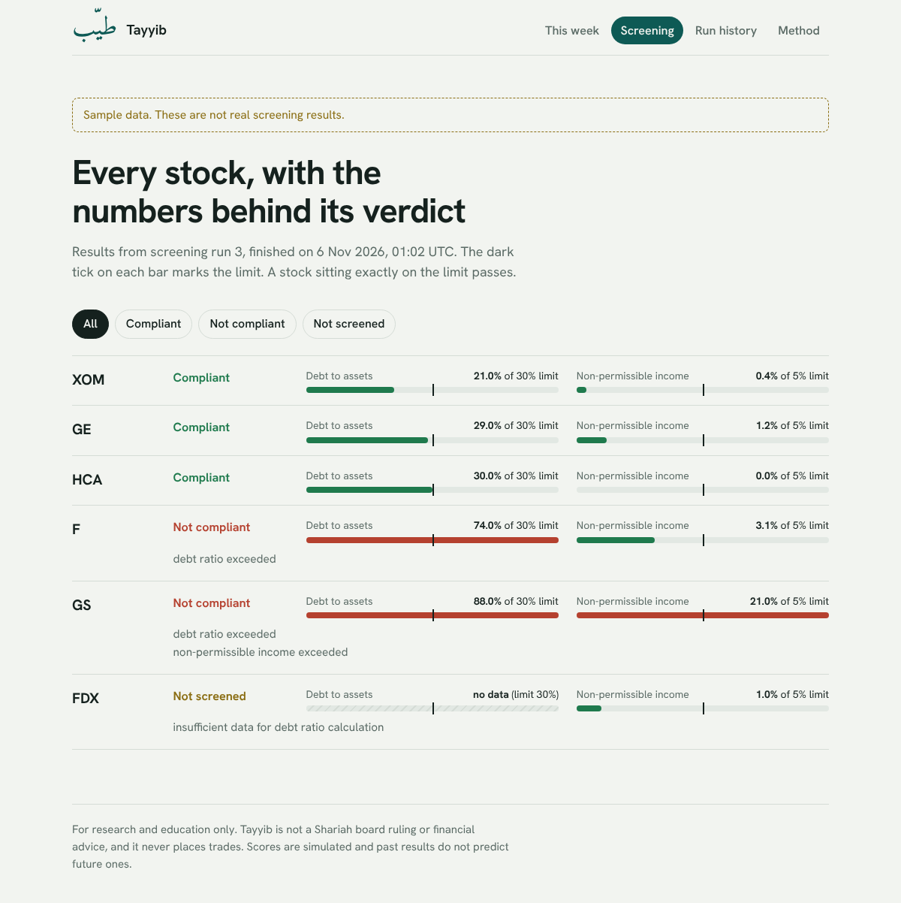
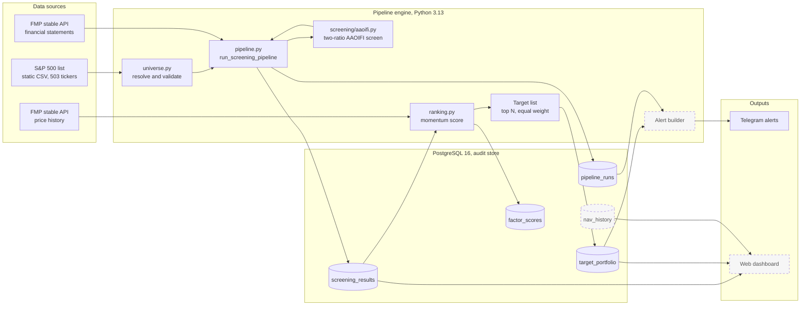

# Tayyib (طيّب)

**Shariah-compliant stock screening, done properly.**

**Live dashboard:** [tayyib-peach.vercel.app](https://tayyib-peach.vercel.app/)

Tayyib is an alert-only stock screening system that applies AAOIFI Shariah compliance rules to a stock universe, ranks compliant stocks by momentum, and sends weekly Telegram alerts. It does not execute trades, you stay in control of every actual transaction.

The name comes from the Quranic concept of *tayyib*, that which is pure and good, beyond merely permissible. It reflects the aspiration this project is building toward: not just a minimum compliance check, but a standard that holds itself to a higher bar as it grows. Most Shariah screeners stop at the floor. The name is a reminder that v1 is just the compliance layer, not the ceiling.

## Status

Actively in development, solo build, 4-week timeline. Eight of the planned capabilities are built, tested, and archived. They cover AAOIFI screening, screening result persistence, pipeline orchestration, and ticker universe resolution, Telegram failure alerts, momentum ranking, the weekly run, and the web dashboard. This is not yet a complete system, see [what's built](#whats-built-so-far) below for exactly what works today versus what's still planned.

## Features (target)

- **AAOIFI screening** — two-ratio implementation with fully documented methodology, deliberately scoped down from AAOIFI's strict three-ratio standard for data-availability reasons, and that deviation is cited, not hidden
- **Momentum ranking** — single-factor model, configurable lookback *(not yet built)*
- **Weekly Telegram alerts** — new entries, exits, action items *(not yet built)*
- **Simulated portfolio tracking** — benchmarked against SPUS *(not yet built)*
- **Audit trail** — every decision traceable to source data, with fixed, explicit reason strings for every non-compliant or unscreened outcome
- **Deterministic** — no AI in the runtime path, same input always produces the same output
- **Modern Python stack** — UV, SQLModel, Pydantic Settings, pytest, Ruff

## What's built so far

| Capability | Status | What it does |
|---|---|---|
| AAOIFI compliance screening | ✅ Built, tested, 100% coverage | Fetches financial data from FMP, computes two ratios, classifies a ticker as compliant, non-compliant, or unscreened with a fixed reason string |
| Screening result persistence | ✅ Built, tested | Stores every screening decision (including failures and unscreened tickers) in PostgreSQL, with generic pipeline-run lifecycle tracking reusable across future steps |
| Pipeline orchestration (screen → persist wiring) | ✅ Built, tested | Connects screening and persistence into one runnable pipeline, with per-ticker fetch-failure isolation (REQ 1.9) and pipeline-wide failure handling (REQ 3.4/4.3) |
| Ticker universe resolution | ✅ Built, tested, 100% coverage | Loads and validates the S&P 500 constituent list (503 tickers) from a checked-in file, and fails fast on a missing, empty, or malformed universe |
| Telegram failure alerts | ✅ Built, tested | Sends a Telegram message when a pipeline run fails, and never lets a delivery problem change the run result |
| Momentum factor ranking | ✅ Built, tested | Scores compliant tickers by 126 day adjusted-close return, selects the top 10 at equal weight, and records every excluded ticker with a fixed reason |
| Weekly run and summary alert | ✅ Built, tested | One command screens the universe, ranks compliant tickers, and sends a Telegram summary with entries and exits |
| Web dashboard | ✅ Built, tested | Next.js app that shows the ranked list, every screening verdict with its numbers, and the run history, reading from Supabase |

Every capability above is developed spec-first using [OpenSpec](https://github.com/Fission-AI/OpenSpec): requirements are written, reviewed, and locked before any code is generated. Archived specs for completed capabilities live in `openspec/changes/archive/`, and live specs for what's currently built are in `openspec/specs/`.

## Dashboard

Live at [tayyib-peach.vercel.app](https://tayyib-peach.vercel.app/). It fills with data after the first weekly run.

A read-only Next.js app in `web/` shows the current list, every screening verdict, and the run history. Each stock shows both ratios as a bar with a tick at the limit, so you can see how close it sits to the line. The screenshots below use sample data, which the app labels with a banner.



## Architecture

Tayyib runs as a one-way pipeline. Data comes in from two sources, passes through a deterministic screening step and a ranking step, and lands in a Postgres audit store. Alerts and the dashboard read from that store. Solid boxes are built and tested today. Dashed boxes are planned.



### How a run works

1. `resolve_universe()` reads the checked-in S&P 500 file and raises if it is missing, empty, blank, or duplicated.
2. `run_screening_pipeline()` opens a tracked run in `pipeline_runs`.
3. For each ticker, the pipeline fetches financial statements from FMP and calls the pure screening function.
4. The pipeline persists exactly one row per ticker in `screening_results`, whatever the outcome.
5. A failed fetch for one ticker records that ticker as unscreened with the reason "financial data fetch failed" and the run continues.
6. Any other failure stops the run and marks it incomplete with a reason, so no run stays stuck in "started".

### Design decisions that shape the code

| Decision | Why |
|---|---|
| Screening is a pure function with no I/O | Same input always gives the same output, and tests need no network or database |
| Three-way result with fixed reason strings | Missing data never turns into a silent pass or fail, and every outcome is auditable |
| Per-ticker isolation catches only `FmpRequestError` | One bad ticker cannot abort a run, while a systemic failure such as a dead database still stops it loudly |
| Static universe file instead of a live API call | The index changes rarely, and a live call would burn API quota on every run |
| No AI in the runtime path | A compliance decision has to be reproducible and explainable |
| Alert-only, no trade execution | The user stays in control of every transaction |

### Code map

| Path | Role |
|---|---|
| `src/tayyib/universe.py` | Universe resolution and validation |
| `src/tayyib/pipeline.py` | Run orchestration and failure handling |
| `src/tayyib/screening/aaoifi.py` | Two-ratio screen and reason vocabulary |
| `src/tayyib/ranking.py` | Momentum score and top N selection |
| `src/tayyib/alerts.py` | Telegram delivery, failure alerts, and the weekly summary |
| `src/tayyib/weekly.py` | Weekly job that runs screening, ranking, then the summary |
| `web/` | Next.js dashboard, server-side reads from Postgres |
| `.github/workflows/` | CI on every push and the weekly scheduled run |
| `scripts/discover_free_universe.py` | Finds which tickers the FMP free plan covers |
| `src/tayyib/data/fmp.py` | FMP client and statement parsing |
| `src/tayyib/storage/` | SQLModel tables, engine, and persistence functions |
| `openspec/specs/` | Live specs for every built capability |
| `openspec/changes/archive/` | Proposal, design, and task history for each change |

## Methodology

Tayyib implements a **deliberately simplified two-ratio version** of AAOIFI Shariah Standard No. 21, which formally defines three ratios measured against market capitalization. This system uses two ratios measured against total assets instead, for two reasons: market cap is volatile and unreliable to compute from the free data tier this project uses, and AAOIFI's second ratio (interest-bearing deposits and investments) isn't cleanly exposed by that same data source.

| Ratio | Formula | Threshold | Basis |
|---|---|---|---|
| Debt ratio | interest-bearing debt (`totalDebt`) / total assets | 30% | FTSE/MSCI convention, not AAOIFI's market-cap basis |
| Non-permissible income | (positive interest income + positive other non-operating income) / total revenue | 5% | AAOIFI Standard 21, ratio expanded to absorb the deposits/investments ratio |

Every ticker is classified as **compliant**, **non-compliant**, or **unscreened**, never defaulted into a pass or fail when data is missing. Non-compliant and unscreened outcomes always carry one or more fixed reason strings, so any result is traceable back to the exact rule and data that produced it.

Boundary rule: a value equal to the threshold passes (strict-exceed, not inclusive-fail).

Two choices keep the screen honest. The debt ratio counts interest-bearing debt only, because payables and deferred revenue carry no interest. Each income figure counts only when positive, so a non-operating loss can never cancel out interest income. The first live run used total liabilities and a signed sum, and the [`fix-screening-ratios`](openspec/changes/archive/) change corrected both.

Full methodology, version history, and every decision's rationale is tracked as [OpenSpec](https://github.com/Fission-AI/OpenSpec) capabilities. See `openspec/specs/` for the current live specs, and `openspec/changes/archive/` for the full review history behind each one.

## Quick Start

```bash
git clone https://github.com/izzahff/tayyib.git
cd tayyib
uv sync
cp .env.example .env
# Add your FMP API key to .env
uv run pytest
```

Start PostgreSQL with `docker compose up -d`, or point `DATABASE_URL` at Supabase. Fill in the Telegram values in `.env` to get alerts.

Run the whole job once with `uv run python -m tayyib.weekly`.

Run the dashboard locally from the `web/` folder. Set `DATABASE_URL`, then run `npm install` and `npm run dev`. Set `DASHBOARD_DEMO=1` to preview it with labelled sample data.

### Deploying

- **Dashboard.** Import the repository in Vercel, set the root directory to `web`, and add `DATABASE_URL` as an environment variable.
- **Weekly job.** Add these repository secrets in GitHub under Settings, Secrets and variables, Actions: `FMP_API_KEY`, `DATABASE_URL`, `TELEGRAM_BOT_TOKEN`, `TELEGRAM_CHAT_ID`. The workflow runs every Monday and can also be started by hand.
- **Daily discovery.** A second workflow checks 90 more tickers against the FMP free plan each morning and commits the updated list, so the weekly universe grows without manual work. Once every ticker is checked, it makes no calls.

## Disclaimer

Tayyib is a personal engineering project applying a documented, cited methodology. It is **not** a Shariah board ruling, fatwa, or religious authority. Individual scholars and jurisdictions may interpret screening criteria differently. Use this tool for research and education, not as a substitute for professional religious or financial advice.

Any performance figures shown by this system, now or in the future, are simulated. Past or simulated performance does not indicate future results.

## License

MIT
